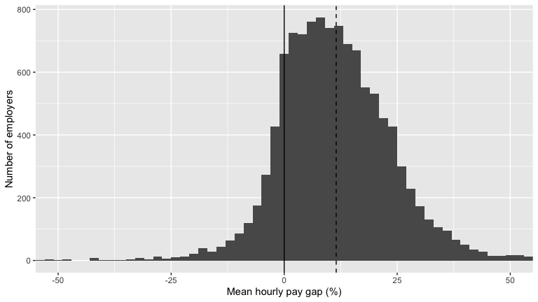
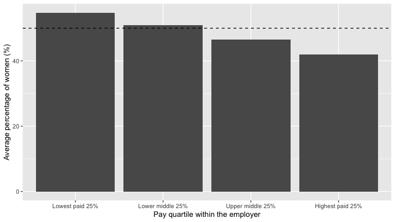

# The UK Gender Pay Gap, 2025 to 2026

**Question:** How large is the gender pay gap across UK employers, how is it spread, and where in the pay structure does it come from?

Every year, UK employers with 250 or more staff must report the difference between the average hourly pay of their male and female employees. This project analyses the 2025 to 2026 returns in R.

**[Read the full report →](UK-Gender-Pay-Gap-Report.md)**

---

## Key findings

| | |
|---|---|
| **11.5%** | Mean gap in hourly pay across 11,193 employers: men are paid 11.5% more |
| **85.0%** | Share of employers where men have the higher mean hourly pay |
| **54.7% → 42.0%** | Women's share of the lowest paid quarter of staff v the highest paid quarter |

- **The typical employer pays men more**, and this is not driven by a few extreme employers. Removing the 138 employers with gaps beyond ±50% barely moves the mean (11.1%).
- **Women are under-represented in the highest paid jobs.** Their share falls steadily from the lowest to the highest pay quartile, which is what produces a gap in average pay.
- **Size and sector make little difference.** The average gap is about 10% to 12% in every size band, and the public sector and businesses look better or worse depending on whether the mean or the median is used.
- **Bonuses:** men and women are about equally likely to get a bonus, but men receive the higher mean bonus at 77.7% of employers that report one.

## What the analysis covers

- **Data checks first:** plotted every employer before averaging, flagged extreme gaps, and checked the late-submission flag against the actual dates (64 "on time" employers submitted after the due date)
- **Distribution and direction** of the gap
- **Pay quartiles**, to show where the gap comes from
- **Employer size and sector**, using an ordered factor for size and missing company numbers to identify the public sector
- **Bonuses**, including impossible values that rule out a simple average
- **Reporting behaviour:** late submissions and name changes
- **Case study:** Vodafone Limited
- **Limitations:** employer-level data, equal weighting of employers, and why a pay gap is not the same as unequal pay for the same job

## Data

[UK Government Gender Pay Gap Service](https://gender-pay-gap.service.gov.uk/viewing/download), 2025 to 2026 reporting year. One row per employer, 27 variables. The data file is not included here; download it from the link.

## Reproducing the report

1. Download the 2025 to 2026 file and save it next to the `.Rmd` as `UK Gender Pay Gap Data - 2025 to 2026.csv`
2. Install the packages: `install.packages(c("tidyverse", "knitr"))`
3. Knit `UK-Gender-Pay-Gap-Report.Rmd` in RStudio

## Tools

R · tidyverse (readr, dplyr, tidyr, ggplot2, lubridate) · knitr

