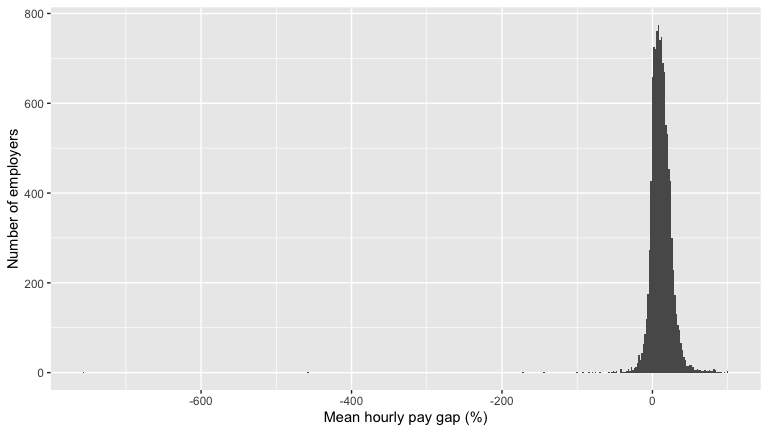
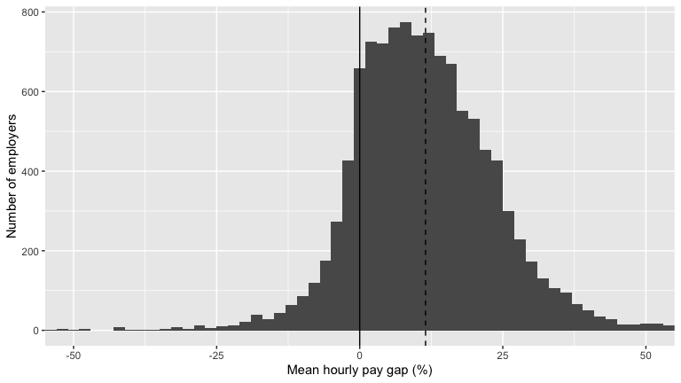
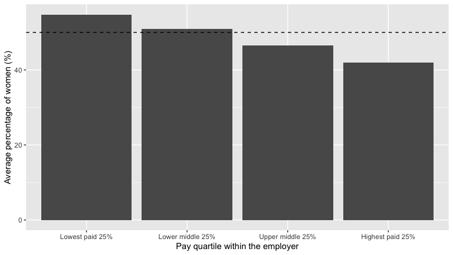
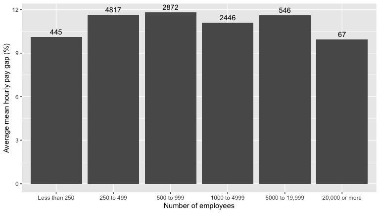

The UK Gender Pay Gap, 2025 to 2026
================

- [Summary](#summary)
- [Reading in the data](#reading-in-the-data)
  - [What does one row represent?](#what-does-one-row-represent)
  - [Data dictionary](#data-dictionary)
- [How large is the gap?](#how-large-is-the-gap)
  - [Look at the data first](#look-at-the-data-first)
  - [The average gap](#the-average-gap)
  - [Who is paid more, men or women?](#who-is-paid-more-men-or-women)
- [Where does the gap come from?](#where-does-the-gap-come-from)
- [Does the gap differ by employer size or
  sector?](#does-the-gap-differ-by-employer-size-or-sector)
  - [Employer size](#employer-size)
  - [Public sector and private
    organisations](#public-sector-and-private-organisations)
- [Bonuses](#bonuses)
- [Reporting behaviour](#reporting-behaviour)
  - [Late submissions](#late-submissions)
  - [Changes of employer name](#changes-of-employer-name)
- [Case study: Vodafone Limited](#case-study-vodafone-limited)
- [Limitations](#limitations)
- [Reproducing this report](#reproducing-this-report)

# Summary

Every year, UK employers with 250 or more staff must report the
difference between the average hourly pay of their male and female
employees. This report uses the 2025 to 2026 reporting year to describe
how large that gap is, how it is spread across employers, and where in
the pay structure it comes from.

Key findings:

- **The typical employer pays men more.** Across 11,193 employers, the
  mean gap in average hourly pay is 11.5%: men are paid 11.5% more than
  women. In 85.0% of employers men have the higher mean hourly pay, in
  14.4% women do, and in 0.6% the two are equal
- **The gap is not caused by a few extreme employers.** A small number
  of employers report very large gaps in either direction (from -757% to
  +100%), but removing the 138 employers with a gap beyond 50% in either
  direction barely changes the mean (11.1%)
- **Women are under-represented in the highest paid jobs.** On average,
  women make up 54.7% of the lowest paid quarter of staff, but only
  42.0% of the highest paid quarter
- **Size and sector make little difference.** The average gap is similar
  across employer sizes (about 10% to 12%), and between the public
  sector and businesses and charities
- **These are employer-level summaries.** The data say nothing about
  individuals, and a pay gap is not the same as unequal pay for the same
  job

------------------------------------------------------------------------

# Reading in the data

The data are published by the UK Government at
<https://gender-pay-gap.service.gov.uk/viewing/download>. Download the
file for 2025 to 2026 and save it in the same folder as this document

``` r
pay.gap <- read_csv("UK Gender Pay Gap Data - 2025 to 2026.csv")
```

`read_csv()` reads the file as a tibble, and blank cells (for example
`CompanyNumber` for public sector employers) are read as `NA`

``` r
glimpse(pay.gap)
```

    ## Rows: 11,193
    ## Columns: 27
    ## $ EmployerName              <chr> "'PRIFYSGOL ABERYSTWYTH' AND 'ABERYSTWYTH UNIVERSITY'", "\"RED B…
    ## $ EmployerId                <dbl> 19070, 16879, 19455, 15320, 687, 17484, 46212, 6290, 14399, 2189…
    ## $ Address                   <chr> "Aberystwyth University, Penglais, Ceredigion, SY23 3FL", "19 Sm…
    ## $ PostCode                  <chr> "SY23 3FL", "EH6 8NU", "SE1 3TQ", "GU1 3BB", "PR7 4AT", "G32 9AT…
    ## $ CompanyNumber             <chr> "RC000641", "SC016876", "08064685", "04104101", "02566586", "SC2…
    ## $ SicCodes                  <chr> NA, "47730", "82990", "85200,\n85310", "93110,\n93130,\n93290", …
    ## $ DiffMeanHourlyPercent     <dbl> 7.97, -2.91, 1.60, 21.48, -14.80, -4.38, 29.13, 17.00, 8.60, 34.…
    ## $ DiffMedianHourlyPercent   <dbl> 0.00, -0.04, 5.60, 17.74, -35.00, -0.06, 3.00, 8.00, 12.10, 33.7…
    ## $ DiffMeanBonusPercent      <dbl> NA, -59.21, -55.20, NA, 2.10, NA, 41.57, -10.00, 19.40, NA, 38.0…
    ## $ DiffMedianBonusPercent    <dbl> NA, -5.26, 28.60, NA, 54.50, NA, 15.00, -25.00, -51.00, NA, 8.80…
    ## $ MaleBonusPercent          <dbl> 0.00, 25.70, 32.00, 0.00, 8.80, 0.00, 90.40, 33.00, 90.20, 0.00,…
    ## $ FemaleBonusPercent        <dbl> 0.00, 74.30, 41.70, 0.00, 17.00, 0.00, 85.20, 65.00, 94.00, 0.00…
    ## $ MaleLowerQuartile         <dbl> 48.30, 35.70, 43.00, 29.00, 53.01, 16.67, 39.60, 84.00, 74.50, 5…
    ## $ FemaleLowerQuartile       <dbl> 51.70, 64.30, 57.00, 71.00, 46.99, 83.33, 60.40, 16.00, 25.50, 4…
    ## $ MaleLowerMiddleQuartile   <dbl> 40.80, 28.60, 60.00, 35.00, 40.96, 10.53, 45.30, 90.00, 91.50, 7…
    ## $ FemaleLowerMiddleQuartile <dbl> 59.20, 71.40, 40.00, 65.00, 59.04, 89.47, 54.70, 10.00, 8.50, 26…
    ## $ MaleUpperMiddleQuartile   <dbl> 36.10, 19.70, 58.00, 51.00, 32.93, 5.56, 43.40, 92.00, 96.80, 81…
    ## $ FemaleUpperMiddleQuartile <dbl> 63.90, 80.30, 42.00, 49.00, 67.07, 94.44, 56.60, 8.00, 3.20, 18.…
    ## $ MaleTopQuartile           <dbl> 53.00, 23.90, 61.00, 70.00, 27.31, 10.53, 67.90, 97.00, 84.00, 9…
    ## $ FemaleTopQuartile         <dbl> 47.00, 76.10, 39.00, 30.00, 72.69, 89.47, 32.10, 3.00, 16.00, 5.…
    ## $ CompanyLinkToGPGInfo      <chr> "https://www.aber.ac.uk/en/equality/equality-reports/genderpayga…
    ## $ ResponsiblePerson         <chr> "Dylan Jones (HR Business Partner (EDI))", "Osmond Ramsay (Manag…
    ## $ EmployerSize              <chr> "1000 to 4999", "250 to 499", "250 to 499", "250 to 499", "250 t…
    ## $ CurrentName               <chr> "'PRIFYSGOL ABERYSTWYTH' AND 'ABERYSTWYTH UNIVERSITY'", "\"RED B…
    ## $ SubmittedAfterTheDeadline <lgl> FALSE, FALSE, FALSE, FALSE, FALSE, FALSE, FALSE, FALSE, FALSE, F…
    ## $ DueDate                   <chr> "2026/04/05 00:00:00", "2026/04/05 00:00:00", "2026/04/05 00:00:…
    ## $ DateSubmitted             <chr> "2026/03/27 13:34:41", "2025/05/23 16:29:27", "2026/04/03 15:39:…

There are 11,193 employers and 27 variables

## What does one row represent?

Each row is one **employer**, not one individual. Employers with 250 or
more staff must report each year, and a few smaller ones report
voluntarily, so the file holds one row per reporting organisation. The
values on a row are summaries of that employer’s workforce: the
percentage difference between male and female mean and median hourly
pay, the same for bonus pay, the percentage of men and women receiving a
bonus, and the percentage of men and women in each of four pay
quartiles. Because the data are already summarised, individual pay is
not visible, and **every employer counts once, whatever its size**

## Data dictionary

“The gender pay gap is the difference between the average earnings of
men and women, expressed relative to men’s earnings. For example, ‘men
earn 15% more than women per hour’.”

| Variable | Description |
|----|----|
| EmployerName | Employer name when the report was submitted |
| EmployerId | Identification number for the employer |
| Address, PostCode | Address and postcode of the employer |
| CompanyNumber | Number from Companies House. Empty for public sector employers |
| SicCodes | Standard industrial classification of economic activities |
| DiffMeanHourlyPercent | $\frac{male~mean - female~mean}{male~mean} \times 100\%$ for hourly pay. Positive means men are paid more |
| DiffMedianHourlyPercent | The same calculation using the median hourly pay |
| DiffMeanBonusPercent | The same calculation using mean bonus pay |
| DiffMedianBonusPercent | The same calculation using median bonus pay |
| MaleBonusPercent | Percentage of males receiving a bonus |
| FemaleBonusPercent | Percentage of females receiving a bonus |
| MaleLowerQuartile, FemaleLowerQuartile | Percentage of the lowest paid quarter of employees that are male or female |
| MaleLowerMiddleQuartile, FemaleLowerMiddleQuartile | The same for the lower middle quarter |
| MaleUpperMiddleQuartile, FemaleUpperMiddleQuartile | The same for the upper middle quarter |
| MaleTopQuartile, FemaleTopQuartile | The same for the highest paid quarter |
| CompanyLinkToGPGInfo | URL to information on the employer’s own web site |
| ResponsiblePerson | Person responsible, often the Managing Director |
| EmployerSize | Text range of the number of employees, e.g. “500 to 999” |
| CurrentName | Matches EmployerName for all but about 1% of employers |
| SubmittedAfterTheDeadline | Logical; about 6% of employers submitted after the deadline |
| DueDate | Date by which the information should have been submitted |
| DateSubmitted | Date and time submitted; no missing data |

------------------------------------------------------------------------

# How large is the gap?

## Look at the data first

Before calculating any averages, I plot the gap for every employer to
check for unusual values

``` r
ggplot(pay.gap, aes(x=DiffMeanHourlyPercent)) +
  geom_histogram(binwidth=2) +
  labs(x="Mean hourly pay gap (%)", y="Number of employers")
```

<figure>

<figcaption aria-hidden="true">Distribution of the mean hourly pay gap
across all employers. Each bar is 2 percentage points wide. Positive
values mean men are paid more.</figcaption>
</figure>

Almost all employers sit in a narrow range, but a few reach far out on
both sides, so the horizontal axis has to stretch a long way. The
extremes are real values in the file, down to -757% and up to a maximum
of 100%. A gap of 100% would mean that women’s mean pay is zero, which
cannot be a real average wage, so the most extreme values probably come
from employers with very few people of one gender in the data, or from
mistakes in the report. I keep every employer in the main results, and
check the effect of the extremes below

``` r
pay.gap <- pay.gap %>%
  mutate(extreme.gap=DiffMeanHourlyPercent < -50 | DiffMeanHourlyPercent > 50)

pay.gap %>% count(extreme.gap)
```

    ## # A tibble: 2 × 2
    ##   extreme.gap     n
    ##   <lgl>       <int>
    ## 1 FALSE       11055
    ## 2 TRUE          138

There are 138 employers with a gap further than 50% from zero. I zoom in
on the other 11,055 employers, where the shape of the distribution is
clear

``` r
overall.mean.gap <- pay.gap %>% summarise(m=mean(DiffMeanHourlyPercent)) %>% pull(m)

ggplot(pay.gap, aes(x=DiffMeanHourlyPercent)) +
  geom_histogram(binwidth=2) +
  geom_vline(xintercept=0) +
  geom_vline(xintercept=overall.mean.gap, lty=2) +
  coord_cartesian(xlim=c(-50, 50)) +
  labs(x="Mean hourly pay gap (%)", y="Number of employers")
```

<figure>

<figcaption aria-hidden="true">The same distribution, zoomed in on gaps
between -50% and +50%. The solid line marks no gap, and the dashed line
marks the mean gap across all employers.</figcaption>
</figure>

The peak is to the right of zero: most employers pay men more

## The average gap

``` r
pay.gap %>%
  summarise(employers=n(),
            mean.gap=mean(DiffMeanHourlyPercent),
            sd.gap=sd(DiffMeanHourlyPercent)) %>%
  kable(digits=1)
```

| employers | mean.gap | sd.gap |
|----------:|---------:|-------:|
|     11193 |     11.5 |     16 |

The mean hourly pay gap across employers is 11.5% (SD 16.0): men are
paid 11.5% more per hour than women. The standard deviation is large
because of the extremes above. Dropping the 138 extreme employers gives
a very similar mean

``` r
pay.gap %>%
  filter(!extreme.gap) %>%
  summarise(employers=n(),
            mean.gap=mean(DiffMeanHourlyPercent),
            sd.gap=sd(DiffMeanHourlyPercent)) %>%
  kable(digits=1)
```

| employers | mean.gap | sd.gap |
|----------:|---------:|-------:|
|     11055 |     11.1 |   11.8 |

Without the extremes, the mean gap is 11.1% (SD 11.8), so the headline
figure does not depend on a handful of unusual employers

## Who is paid more, men or women?

``` r
pay.gap %>%
  mutate(direction=case_when(DiffMeanHourlyPercent > 0 ~ "Men paid more",
                             DiffMeanHourlyPercent < 0 ~ "Women paid more",
                             TRUE ~ "Equal")) %>%
  count(direction) %>%
  kable()
```

| direction       |    n |
|:----------------|-----:|
| Equal           |   63 |
| Men paid more   | 9515 |
| Women paid more | 1615 |

``` r
pay.gap %>%
  summarise(men.higher=mean(DiffMeanHourlyPercent > 0)*100,
            women.higher=mean(DiffMeanHourlyPercent < 0)*100,
            equal=mean(DiffMeanHourlyPercent == 0)*100) %>%
  kable(digits=1)
```

| men.higher | women.higher | equal |
|-----------:|-------------:|------:|
|         85 |         14.4 |   0.6 |

Men have the higher mean hourly pay in 9,515 employers (85.0%), women in
1,615 (14.4%), and the two are equal in 63 (0.6%). Pay gaps in favour of
women do exist, but they are much rarer

------------------------------------------------------------------------

# Where does the gap come from?

The gap compares average pay, so it is driven by who does which jobs.
Each employer reports what percentage of its lowest paid, lower middle,
upper middle and highest paid quarters of staff are women

``` r
quartile.shares <- pay.gap %>%
  pivot_longer(cols=c(FemaleLowerQuartile, FemaleLowerMiddleQuartile, FemaleUpperMiddleQuartile, FemaleTopQuartile),
               names_to="quartile", values_to="percent.female") %>%
  mutate(quartile=factor(quartile,
                         levels=c("FemaleLowerQuartile", "FemaleLowerMiddleQuartile", "FemaleUpperMiddleQuartile", "FemaleTopQuartile"),
                         labels=c("Lowest paid 25%", "Lower middle 25%", "Upper middle 25%", "Highest paid 25%")))

quartile.shares %>%
  group_by(quartile) %>%
  summarise(employers=n(), mean.percent.female=mean(percent.female)) %>%
  kable(digits=1)
```

| quartile         | employers | mean.percent.female |
|:-----------------|----------:|--------------------:|
| Lowest paid 25%  |     11193 |                54.7 |
| Lower middle 25% |     11193 |                50.9 |
| Upper middle 25% |     11193 |                46.6 |
| Highest paid 25% |     11193 |                42.0 |

``` r
quartile.shares %>%
  group_by(quartile) %>%
  summarise(mean.percent.female=mean(percent.female)) %>%
  ggplot(aes(x=quartile, y=mean.percent.female)) +
  geom_col() +
  geom_hline(yintercept=50, lty=2) +
  labs(x="Pay quartile within the employer", y="Average percentage of women (%)")
```

<figure>

<figcaption aria-hidden="true">Average percentage of women in each pay
quartile across employers. The dashed line marks an equal split of
50%.</figcaption>
</figure>

Women are the majority (54.7%) of the lowest paid quarter of staff, and
the share falls steadily to 50.9%, 46.6% and finally 42.0% in the
highest paid quarter. In 81.2% of employers women make up a smaller
share of the top quarter than of the bottom quarter. Women are
concentrated in lower paid jobs and men in higher paid jobs, which is
exactly what produces a gap in average pay

------------------------------------------------------------------------

# Does the gap differ by employer size or sector?

## Employer size

`EmployerSize` is text, so R would sort it alphabetically. I turn it
into an ordered factor with the sizes from smallest to largest

``` r
pay.gap <- pay.gap %>%
  mutate(EmployerSize=factor(EmployerSize,
                             levels=c("Not Provided", "Less than 250", "250 to 499", "500 to 999",
                                      "1000 to 4999", "5000 to 19,999", "20,000 or more"),
                             ordered=TRUE))

(  gap.by.size <- pay.gap %>%
     group_by(EmployerSize) %>%
     summarise(employers=n(), mean.gap=mean(DiffMeanHourlyPercent), sd.gap=sd(DiffMeanHourlyPercent))  ) %>%
  kable(digits=1)
```

| EmployerSize   | employers | mean.gap | sd.gap |
|:---------------|----------:|---------:|-------:|
| Less than 250  |       445 |     10.1 |   17.7 |
| 250 to 499     |      4817 |     11.6 |   19.2 |
| 500 to 999     |      2872 |     11.8 |   13.4 |
| 1000 to 4999   |      2446 |     11.1 |   12.0 |
| 5000 to 19,999 |       546 |     11.6 |   11.7 |
| 20,000 or more |        67 |      9.9 |    9.3 |

``` r
ggplot(gap.by.size, aes(x=EmployerSize, y=mean.gap)) +
  geom_col() +
  geom_text(aes(label=employers), vjust=-0.5) +
  labs(x="Number of employees", y="Average mean hourly pay gap (%)")
```

<figure>

<figcaption aria-hidden="true">Average mean hourly pay gap by employer
size. The number above each bar is the number of employers.</figcaption>
</figure>

The average gap is between 10% and 12% in every size band, with no clear
pattern: it is 11.6% for employers with 250 to 499 staff and 11.1% for
those with 1,000 to 4,999. The largest employers (20,000 or more staff,
only 67 of them) have the smallest gap, at 9.9%. The standard deviations
are large (9 to 19 percentage points), so differences of a percentage
point between bands are well within the variation between employers

## Public sector and private organisations

The data dictionary says that `CompanyNumber` is empty for public sector
employers, so I use that to make a new `Sector` column. `is.na()` is
needed here, because `== NA` never works

``` r
pay.gap <- pay.gap %>%
  mutate(Sector=if_else(is.na(CompanyNumber), "Public Sector", "Business / Charity"))

pay.gap %>%
  group_by(Sector) %>%
  summarise(employers=n(),
            mean.gap=mean(DiffMeanHourlyPercent),
            mean.median.gap=mean(DiffMedianHourlyPercent)) %>%
  kable(digits=1)
```

| Sector             | employers | mean.gap | mean.median.gap |
|:-------------------|----------:|---------:|----------------:|
| Business / Charity |      9672 |     11.6 |            10.9 |
| Public Sector      |      1521 |     10.9 |            12.0 |

Using the mean hourly pay gap, the gap is slightly smaller for the 1,521
public sector employers (10.9%) than for the 9,672 businesses and
charities (11.6%). But the answer reverses if we use the gap in median
hourly pay: 12.0% in the public sector against 10.9% in business. The
two sectors are very close, and which one looks better depends on the
measure, so I do not conclude that either has a smaller pay gap

------------------------------------------------------------------------

# Bonuses

Employers also report how many men and women received a bonus, and the
gap in bonus pay

``` r
pay.gap %>%
  summarise(male.bonus.percent=mean(MaleBonusPercent), female.bonus.percent=mean(FemaleBonusPercent)) %>%
  kable(digits=1)
```

| male.bonus.percent | female.bonus.percent |
|-------------------:|---------------------:|
|               38.2 |                 37.7 |

On average, 38.2% of men and 37.7% of women receive a bonus at each
employer, so the chance of receiving a bonus is almost the same. The
size of the bonus is a different matter. Employers that pay no bonus
have `NA` in the bonus gap columns, so I leave them out

``` r
pay.gap %>%
  filter(!is.na(DiffMeanBonusPercent)) %>%
  mutate(men.higher=DiffMeanBonusPercent > 0) %>%
  count(men.higher) %>%
  kable()
```

| men.higher |    n |
|:-----------|-----:|
| FALSE      | 1882 |
| TRUE       | 6567 |

``` r
pay.gap %>%
  filter(!is.na(DiffMeanBonusPercent)) %>%
  summarise(employers=n(), percent.men.higher=mean(DiffMeanBonusPercent > 0)*100) %>%
  kable(digits=1)
```

| employers | percent.men.higher |
|----------:|-------------------:|
|      8449 |               77.7 |

Among the 8,449 employers that report a bonus gap, men receive the
higher mean bonus in 6,567 (77.7%). I do not report an average bonus
gap, because the bonus columns contain some impossible values (for
example a median bonus gap of -1,000,000,000%) that would make any
average meaningless without careful cleaning

------------------------------------------------------------------------

# Reporting behaviour

## Late submissions

``` r
pay.gap %>%
  group_by(SubmittedAfterTheDeadline) %>%
  summarise(employers=n(), mean.gap=mean(DiffMeanHourlyPercent)) %>%
  kable(digits=1)
```

| SubmittedAfterTheDeadline | employers | mean.gap |
|:--------------------------|----------:|---------:|
| FALSE                     |     10504 |     11.6 |
| TRUE                      |       689 |      9.9 |

689 employers (6.2%) submitted late. Their mean gap is 9.9%, compared to
11.6% for the 10,504 employers who were on time. That is a difference of
1.7 percentage points, and I cannot tell from these data whether it is
more than chance

Before trusting the flag, I check it against the dates. `DateSubmitted`
should be later than `DueDate` for a late employer. The dates are text
written year/month/day, so `ymd_hms()` turns them into proper date-times

``` r
pay.gap <- pay.gap %>%
  mutate(DateSubmitted.dt=ymd_hms(DateSubmitted),
         DueDate.dt=ymd_hms(DueDate),
         submitted.after.due.date=DateSubmitted.dt > DueDate.dt)

pay.gap %>% count(SubmittedAfterTheDeadline, submitted.after.due.date)
```

    ## # A tibble: 3 × 3
    ##   SubmittedAfterTheDeadline submitted.after.due.date     n
    ##   <lgl>                     <lgl>                    <int>
    ## 1 FALSE                     FALSE                    10440
    ## 2 FALSE                     TRUE                        64
    ## 3 TRUE                      TRUE                       689

All 689 employers flagged as late did submit after the due date. But 64
employers flagged as on time have a submission date after the due date.
A possible reason is that they submitted on time and then sent a
correction later, but the data do not say. The late flag is therefore
slightly less reliable than it looks

## Changes of employer name

``` r
pay.gap <- pay.gap %>%
  mutate(NameChange=EmployerName != CurrentName)

pay.gap %>%
  group_by(NameChange) %>%
  summarise(employers=n(), mean.gap=mean(DiffMeanHourlyPercent)) %>%
  kable(digits=1)
```

| NameChange | employers | mean.gap |
|:-----------|----------:|---------:|
| FALSE      |     11089 |     11.5 |
| TRUE       |       104 |     13.3 |

The 104 employers that have changed their name have a mean gap of 13.3%,
compared to 11.5% for the 11,089 that have not. With only 104 employers
and such variable gaps, I treat this as a curiosity, not a finding

------------------------------------------------------------------------

# Case study: Vodafone Limited

To show what an individual row looks like, here is one large employer.
`grepl()` finds every employer whose name contains “VODAFONE”, and
`ignore.case=TRUE` means capital letters do not matter

``` r
pay.gap %>%
  filter(grepl("VODAFONE", EmployerName, ignore.case=TRUE)) %>%
  select(EmployerName, EmployerSize, DiffMeanHourlyPercent, DiffMedianHourlyPercent) %>%
  kable(digits=1)
```

| EmployerName | EmployerSize | DiffMeanHourlyPercent | DiffMedianHourlyPercent |
|:---|:---|---:|---:|
| VODAFONE GROUP SERVICES LIMITED | 1000 to 4999 | 8.2 | 7.8 |
| VODAFONE LIMITED | 5000 to 19,999 | 7.7 | 10.9 |
| VODAFONE SHARED SERVICES UK LIMITED | 500 to 999 | 6.2 | 7.5 |

There are three Vodafone entries. I take the main company, Vodafone
Limited, and look at its quartiles

``` r
pay.gap %>%
  filter(EmployerName == "VODAFONE LIMITED") %>%
  select(contains("Quartile")) %>%
  pivot_longer(everything(), names_to="quartile", values_to="percent") %>%
  kable(digits=1)
```

| quartile                  | percent |
|:--------------------------|--------:|
| MaleLowerQuartile         |    53.8 |
| FemaleLowerQuartile       |    46.2 |
| MaleLowerMiddleQuartile   |    65.0 |
| FemaleLowerMiddleQuartile |    35.0 |
| MaleUpperMiddleQuartile   |    67.8 |
| FemaleUpperMiddleQuartile |    32.2 |
| MaleTopQuartile           |    67.2 |
| FemaleTopQuartile         |    32.8 |

Vodafone Limited has a mean hourly pay gap of 7.7% (and a median gap of
10.9%), which is lower than the average employer. The quartiles show a
fairly equal split among the lowest paid 25% of staff (53.8% male, 46.2%
female) but a clear imbalance among the highest paid 25% (67.2% male,
32.8% female). The upper middle quartile is similar to the top (67.8%
male, 32.2% female). This is the same pattern as in the whole data set:
women are concentrated in lower paid jobs and men in higher paid jobs

------------------------------------------------------------------------

# Limitations

- **Employers, not people.** Each row summarises a whole workforce. A
  relationship between employers (for example, size and gap) need not
  hold for individuals
- **Every employer counts once.** An employer with 250 staff has the
  same weight as one with 50,000, so the averages describe the typical
  employer, not the typical worker
- **A pay gap is not unequal pay.** The gap compares average pay across
  all jobs, so it is largely driven by the mix of jobs men and women do.
  It does not say that men and women are paid differently for the same
  work
- **Small employers.** For employers with few staff, one high earner can
  move the gap a long way, which explains the extremes
- **Binary measure and one year.** The data classify staff as male or
  female, and cover only one reporting year, so they cannot show a trend
- **Data quality.** Some values are clearly impossible (see Bonuses),
  and there is a mismatch in the late submission flag. I did not correct
  the original data, and I did not remove any employers from the main
  results

# Reproducing this report

1.  Download the 2025 to 2026 file from the [government’s download
    page](https://gender-pay-gap.service.gov.uk/viewing/download) and
    save it next to this `.Rmd` as
    `UK Gender Pay Gap Data - 2025 to 2026.csv`
2.  Install the packages with
    `install.packages(c("tidyverse", "knitr"))`
3.  Knit the document in RStudio, or run
    `rmarkdown::render("UK-Gender-Pay-Gap-Report.Rmd")`
